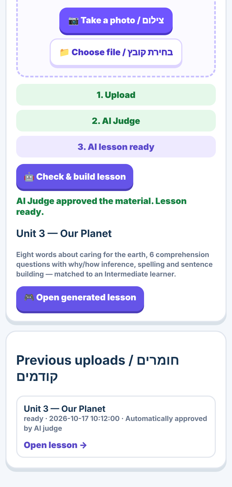
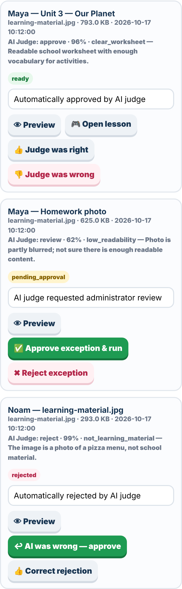
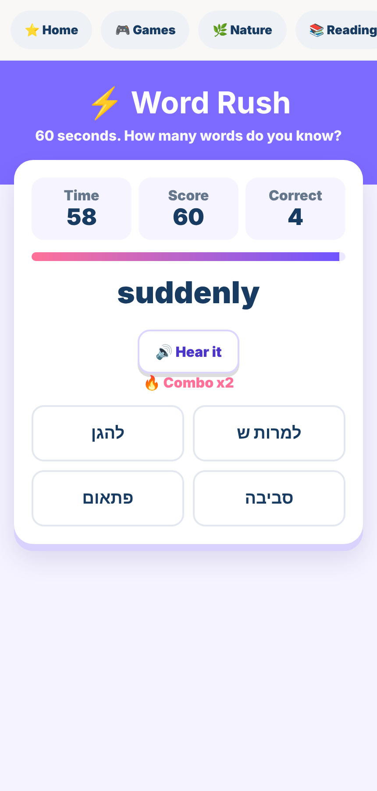
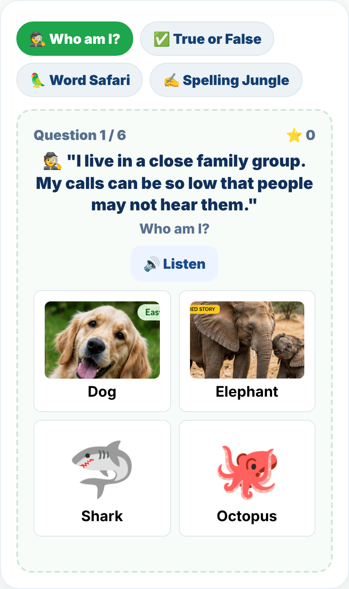

# ⭐ English Star

**An AI-assisted English practice app I built for my family.** Parents photograph a school worksheet, an AI judge decides whether it's worth processing, and an LLM turns it into a personalised lesson (vocabulary, comprehension, spelling, sentence building) matched to the child's English level. Around it sits a set of games for Hebrew-speaking kids learning English.

It runs in production for my family. The repository stays private because it contains my children's school work; this page describes the design.

<p>
  
  
  
</p>

<sub>Screenshots use sample data.</sub>

---

## Architecture

| Layer | Choice |
|---|---|
| API and hosting | Cloudflare Workers (Hono), static assets served from the same Worker |
| Data | Cloudflare D1 (SQLite) with versioned migrations |
| Files | Cloudflare R2, private bucket, never publicly addressable |
| AI | Cloudflare Workers AI (Gemma) for extraction, judging and lesson generation |
| Auth | Clerk sign-in for all family and admin APIs |
| Deploy | Push to `main` → Cloudflare build → deploy |

## The upload pipeline

```
photo / PDF
  → type decided from the file's bytes, not the browser's label
  → SHA-256 dedupe (same file twice = no second AI call)
  → atomic quota slot: per family per day + global per day, in one SQL statement
  → private R2 storage
  → text extraction
  → AI judge: approve / reject / send to admin, with confidence thresholds
  → lesson generation, constrained to the child's English level
  → assignment + items saved; the child plays it as a game
```

### AI judge with a human in the loop

Before spending the larger generation budget, a cheap model call decides whether an upload is real learning material.

- **Asymmetric thresholds:** auto-approve needs ≥ 80% confidence, auto-reject needs ≥ 95%. Anything in between goes to an admin queue, so a wrong rejection is rarer than a wrong approval.
- **It learns from corrections:** when the admin overrides or confirms a decision, the case is stored as trusted memory and fed back into the judge's prompt as examples. The latest correction for an upload replaces earlier ones.
- **Untrusted input is treated as data:** text extracted from a photo is wrapped and marked as untrusted, and a judge that flags prompt injection is forced to "review" regardless of its confidence.

### Cost control that can't be configured away

AI limits (uploads per family per day, uploads per day overall, file size, extracted tokens, output tokens) have **hard ceilings in code**. Environment variables and the admin settings page can tune them, but never above the ceiling. Token usage and estimated cost are recorded per upload and shown on the admin dashboard.

### Difficulty that actually changes

Each child has an English level (automatic from school grade, or Beginner → Advanced). The level sets the number of words and questions, the question type (direct recall vs. inference), maximum sentence length and spelling word length in the generation prompt. The model's output is then **clamped to the level in code**, so a verbose model can't exceed it.

## Privacy and security

- **Per-family data boundary:** every child route checks that the child belongs to the signed-in family; all SQL is parameterised.
- **Children's photos are deleted after 14 days** by a scheduled job, with a hard ceiling in code.
- **Private pages for my own kids** are served through the Worker and only to the owner account.
- **Admin controls:** freeze an account (checked server-side, fails closed), override the judge, full audit log of admin actions.
- Hardened after a self-review: static files served only from `public/`, security headers, stored-XSS fix on AI-generated titles, server-side XP.

## The games

Built for 9–10-year-olds, designed so guessing doesn't win: shuffled answers with plausible distractors, two tries before the answer is shown, and XP only for first- or second-try answers.

- **Word Rush:** 60-second vocabulary race across four levels, with combos and personal bests
- **Nature Explorer:** animal stories plus riddles, true/false, vocabulary and spelling games built from them
- **Reading library:** Easy / Medium / Hard texts, where XP requires answering a comprehension question
- **Hero English:** superhero-themed reading and a "make your own hero" sentence builder
- **School work:** written Hebrew-meaning tests and fill-the-gap practice for a child's actual vocabulary list



---

[← Back to profile](README.md)
